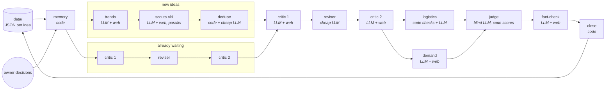
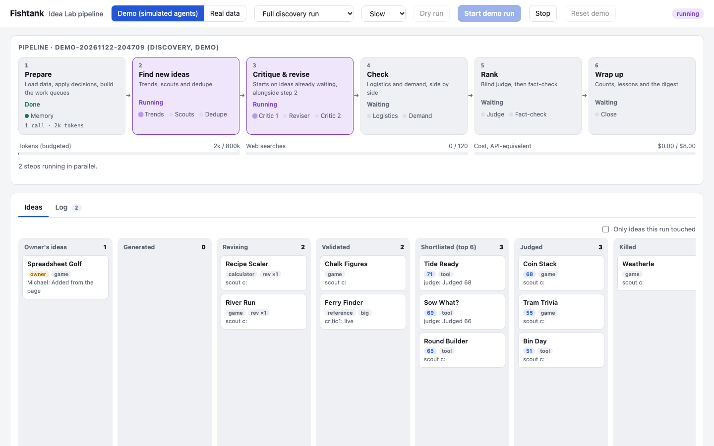

# Fishtank

An agent pipeline that generates, critiques, verifies and ranks ideas for small websites, which I
then build and run. It is the idea factory behind my side projects, and an exercise in building LLM
systems that are cheap, testable and accountable.

```
memory → trends → scouts → dedupe → critic → reviser → critic 2 → logistics → demand → judge → fact-check → close
```

Each run produces a ranked shortlist. Every claim in it carries a source, each score is computed
from a rubric, and the whole run is recorded as a readable git diff. I make the final call on every
idea, and those calls feed back into the next run.

## Contents

- [Background](#background)
- [Architecture](#architecture)
- [Design decisions](#design-decisions)
- [Evaluation](#evaluation)
- [Workflow](#workflow)
- [Watch it run](#watch-it-run)
- [Quick start](#quick-start)
- [Project layout](#project-layout)
- [Roadmap](#roadmap)

## Background

The first version was a prompt-orchestrated prototype. A 40 KB prose playbook told one orchestrating
agent how to run around 25 sub-agents through scouting, criticism, revision and judging. That was
the right way to discover the process: I revised the playbook eleven times across 32 runs as I
learned what produced good ideas.

It was the wrong way to run that process for good:

- **Cost:** open-ended research by every agent, with no budget, made each run expensive.
- **Reliability:** a run killed by a usage limit had to start again from scratch.
- **No tests or diffs:** the logic lived in prose, so there was nothing to test, diff or review.
- **Unreliable maths:** a language model did arithmetic and bookkeeping, and scores drifted between
  passes with no new evidence.

This repo is the re-architecture. Everything that is a rule became code, everything that needs
judgement became a small, versioned prompt with a schema, and the orchestration became a graph.

## Architecture



- **Orchestration:** a LangGraph DAG with a SQLite checkpointer. Independent branches run concurrently;
  a plain-Python engine runs the same nodes one at a time in topological order without LangGraph.
- **Nodes:** each node is a function `(state, ctx) -> update`. It reads its own work queue from the
  data at the start, so re-running a node after a crash only handles what it hadn't finished.
- **Models:** each role gets its own model and effort setting, chosen in a single config map:
  - a small model for classification, dedupe and rewrites;
  - a mid-size model for research roles;
  - the strongest model only for the judge.
- **Backend:** model calls go through the Claude CLI in headless mode, locally and in CI, with
  structured output against each role's schema and a per-call search cap. A demo backend swaps in
  simulated agents.
- **Storage:** git-tracked JSON, one file per idea and per run. The data lives in a separate private
  repo, and this repo ships a fictional `sample_data/` set with the same shape.

| Step | Model | Code |
|---|---|---|
| memory | small model, once per new idea (idea map) | Work queues, taste summary from my decisions, idea map, live-site results |
| scouts | mid model, capped searches | Briefs rolled with `SystemRandom` under no-repeat rules (no audience+format pair from the last 7 runs) |
| dedupe | small model | Fuzzy title matching first; the model only flags near-variants; caps per batch |
| critic 1 / 2 | mid model, batched, capped searches | Stage transitions, the 2-revision cap, owner's ideas never killed on a first pass |
| reviser | small model, no web | Revision history, pivots become new ideas with a parent link |
| logistics | mid model, few searches | RDAP domain lookups, cited-URL checks and licence-page fetches *before* the model sees the idea |
| judge | strongest model, no web, blind | Total from weights, famous-original caps, stability limits, top-6 ranking |
| fact-check | mid model, capped searches | Score changes clamped to downward only, max −2 |
| close | none | Counts, per-angle yield, digest, notifications |

## Design decisions

**Use a model only where judgement is needed.** The prototype asked a model to do dedupe, arithmetic,
date maths and state transitions. It got them mostly right, but "mostly" is a bug when it decides
the ranking. Each step was sorted into judgement or rule. Rules became pure functions in
`rules.py`, with unit tests that pin every rule from the original spec.

**The judge is blind, and it doesn't do the maths.** The judge sees a pitch and its evidence. It
never sees who proposed the idea, how often it was revised, or its previous stage. It returns seven
0–5 scores and a few flags, and code computes `round(Σ weight·score / 65 · 100)` and applies the
caps. One rule is that copying a famous free game caps the "gap" score, however good the pitch
sounds. The model reports whether a famous original applies, and code enforces the cap.

**Stability without new evidence.** In the prototype, one idea's score slid from 69 to 51 over three
passes with no new evidence. Now a criterion can move by more than one point only if new evidence has arrived
since the last score: a critique, a demand hunt, a logistics check or a fact-check. Timestamps on
the evidence decide this, not the model.

**Asymmetric verification.** The fact-checker exists to find what the critics missed. It can lower a
score and can't raise one, so a confident hallucination can't push an idea up the board.

**Facts are checked in code before the model judges them.** Domain availability comes from RDAP
(Verisign for .com, Nominet for .uk). Every cited URL is resolved, and licence pages are fetched
and handed to the model as text. The model's job is to read and judge, not to recall.

**The human is in the loop, and protected.** My decisions (select, park, reject, building, hosted)
are the ground truth. The store refuses any pipeline write to a decided idea except an appended
history line. Decisions flow in through one audited path: a YAML file, or change files exported
from the viewer. Decisions also become the evaluation labels.

**Cost is a first-class input.**

- Every run has a token, search and dollar budget. When one is hit, the graph routes straight to
  judge → close, so a run always ends with a ranking.
- `--dry-run` prints the planned calls per node, with token, search and cost estimates, before
  anything is spent.
- Usage is recorded per node in the run file.
- Domain, URL and licence results are cached. Stable carry-over ideas are re-checked monthly, not
  weekly.

**Parallel where the data allows it, not where it looks tidy.** The order inside one idea is fixed:
critic 2 checks the reviser's answer to critic 1, so those can't overlap for the same idea. They can
across ideas, though. Work that was already waiting when a run starts (my own submitted ideas, due
revisions, revised-but-unchecked ideas) runs as its own branch while trends and scouts research.
Scouts run concurrently but meet at dedupe, because dedupe has to see the whole batch to catch two
scouts proposing the same thing and to apply the per-run caps. Logistics and demand are independent
checks that write different fields, so they run side by side and join at the judge, which scores
everything on one scale. Parallelism changes wall-clock time, not cost:

- every model call in the process shares one bounded pool of slots, so extra branches can't trip a
  rate limit;
- every idea write takes a per-file lock, so two branches can't lose each other's updates.

**Failure is a normal path.** Usage limits, rate limits and timeouts are typed errors. A limit stops
the run cleanly with its state saved, and `run --resume <id>` continues from the last finished node.
Other model errors are logged and the batch is skipped. Every role returns schema-constrained JSON.

## Evaluation

There are two layers.

**Deterministic tests** (`tests/`, no network, no tokens) cover:

- every scoring and state-transition rule;
- the dice no-repeat rules;
- decision handling, including that a decision is applied exactly once;
- budget routing, and resume after a simulated usage limit;
- a full discovery run through every node, using simulated agents with random answers;
- full judge and fact-check passes against a fake model, which also asserts the judge never
  receives a field that would break blindness.

They run in CI on every push.

**Model evals** (`python -m idea_lab eval`) measure the judge against reality: my own decisions.

| Metric | Question it answers |
|---|---|
| Taste: pairwise accuracy | Over every (picked, rejected) pair, how often does the judge score the picked idea higher? 0.5 is chance. |
| Taste: rank correlation | Spearman correlation between the total and the label (rejected 0 / parked 1 / picked 2). |
| Stability | With identical inputs, how far does an idea's total move across repeats, and which criteria wobble? |
| Baseline | The same taste metrics on the scores already stored, i.e. what production currently says. |

Two details matter:

- **Leakage.** The judge's normal brief includes a summary of my taste, built from those same
  decisions. Evaluating with it would hand the judge the answer. Ideas are split into folds, and each
  fold is judged with a taste summary built only from decisions outside it.
- **Same post-processing.** Eval scores go through the same caps as production, so the eval
  measures what the leaderboard would show, not the raw model output.

Each report records the model, the backend and a hash of the judge prompt. That makes
`eval --list` a regression history: a prompt or model change ships only if taste agreement holds
and stability doesn't get worse. The labelled set grows with every decision I make in the viewer.

## Workflow

How I build and change this system:

1. **Prototype in prose, then port.** New behaviour starts as an instruction to an agent, because
   that's the fastest way to learn what works. Once it's stable, I decide what it really is: a rule,
   a judgement, or a check against the world.
2. **Rules first, with tests.** Rules land in `rules.py` or `steps/` as pure functions, with tests
   taken from the spec, before any prompt changes.
3. **Prompts are code.** Each role has one prompt file and one JSON schema. Shared rules live in a
   single file. Prompts are reviewed and diffed like code, and the prompt hash goes into every eval
   report.
4. **Measure before switching.** Any change to the judge, its prompt or its model runs through the
   eval first and is compared with the stored baseline.
5. **Dry-run, then a budgeted run.** Every run is planned and estimated before it spends anything,
   and capped while it runs.
6. **Review the diff.** A run's output is a git diff of JSON files, which I read before committing.
   Git history is the audit log for every idea.
7. **Decisions close the loop.** What I pick and reject becomes context for the next run and labels
   for the next eval.

## Watch it run

```sh
python -m idea_lab serve --open        # http://127.0.0.1:8765
```



A local dashboard to watch a run happen:

- **Pipeline:** six phases (prepare, find new ideas, critique & revise, check, rank, wrap up). Each shows
  whether it's waiting, running, done or had nothing to do, with a dot per step. Phases that run in
  parallel light up together.
- **Budget meters:** fill against the run's caps.
- **Ideas tab:** ideas move between stage columns as critics, revisers and the judge act on them.
- **Log tab:** the live log, plus a per-step table of model, status, calls, tokens and searches.

Click any idea for its scores, evidence and full history, and to pick, park or reject it.

**Demo mode** runs the real pipeline (queues, rules, caps, stage transitions, budgets, checkpoints) on a
scratch copy of the sample data, with simulated agents that return schema-valid answers. It needs no
keys and no network, and spends no tokens. **Real data** mode shows the dry-run estimate and asks before
spending anything.

## Quick start

```sh
python -m venv .venv && .venv/bin/pip install -e '.[all]'
.venv/bin/python -m unittest discover -s tests          # no network, no tokens

export IDEA_LAB_DATA=sample_data                         # fictional ideas, same shape as the real data
.venv/bin/python -m idea_lab status                      # leaderboard and work queues
.venv/bin/python -m idea_lab run --dry-run               # planned calls per node, estimated cost
.venv/bin/python -m idea_lab eval --dry-run              # planned judge-eval calls
.venv/bin/python -m idea_lab view && open out/index.html # the leaderboard UI
```

Real runs need the Claude CLI (`claude`, logged in). In CI it uses a token from `claude setup-token`.

Useful commands:

```sh
python -m idea_lab run                                  # full discovery run, budget on
python -m idea_lab run --type maintenance               # revisions, checks and judging only
python -m idea_lab run --only judge,factcheck           # selected nodes (memory and close always run)
python -m idea_lab run --resume <run_id>                # continue after a limit or Ctrl-C
python -m idea_lab eval --repeats 3 --folds 3           # judge eval; --list for history
python -m idea_lab apply                                # apply decisions and viewer change files
```

Budgets, models per role, search caps, batch sizes and the number of concurrent model calls (`IDEA_LAB_PARALLEL`, default 3) all live in `idea_lab/config.py`. Most can
also be set with flags or `IDEA_LAB_*` environment variables.

## Project layout

```
idea_lab/
  graph.py          LangGraph wiring, budget routing, plain-Python engine
  nodes.py          one function per step; queues derived from data
  rules.py          scoring, caps, stability, stage transitions, protection (pure)
  llm.py            backends, structured output, usage and budget accounting
  evals.py          judge eval: taste agreement, stability, leakage control
  prompts/          one prompt per role + shared rules
  schemas.py        JSON schema per role
  checks/           RDAP, URL and licence-page checks (pure code)
  steps/            memory/queues, dedupe, close/digest (pure code)
  decisions.py      the only path that may change a decided idea
  store.py          JSON store with the protection guard
  serve.py, web/    local dashboard: live pipeline, stage board, log, decisions
  demo.py           simulated agents for demo runs and the end-to-end test
  view.py           static leaderboard UI with a decision export
tests/              deterministic tests (fake model)
sample_data/        fictional dataset for tests, CI and the quick start
.github/workflows/  tests on every push; manual pipeline run
```

## Roadmap

- **Rival-research cache:** competitor research cached per idea, so stable carry-overs aren't
  re-researched.
- **Critic eval:** labels from ideas the critics killed that later turned up elsewhere as real
  products.
- **"Second chance" reviews:** kills with a fixable reason get one revision.
- **Build briefs:** a brief written automatically for ideas I pick.
- **Viewer:** hosted behind access control, with decision buttons writing straight to the store.
